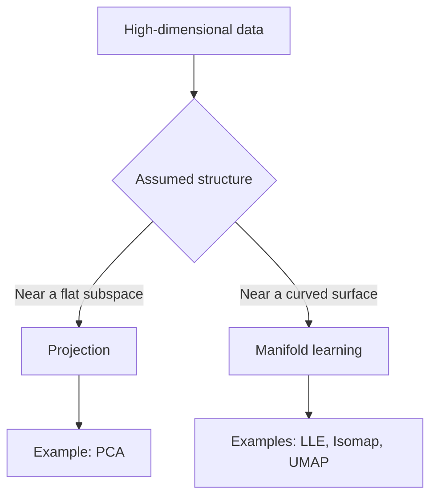

# Chapter 8: Dimensionality Reduction

## Learning objectives

By the end of this lesson, you should be able to:

- explain the curse of dimensionality;
- distinguish feature selection from feature extraction;
- describe projection and manifold learning;
- explain how Principal Component Analysis (PCA) chooses components;
- select the number of dimensions using explained variance;
- apply PCA correctly in a machine-learning pipeline;
- recognize when dimensionality reduction may damage useful information.

---

## 1. Why reduce dimensionality?

Many datasets contain hundreds, thousands, or even millions of features. A large
feature space can:

- increase training time and memory use;
- make models more prone to overfitting;
- make distance and similarity less informative;
- hide important structure behind noise and redundant features;
- prevent direct visualization.

**Dimensionality reduction** transforms data into a representation with fewer
features while trying to preserve useful information.

For example, neighboring pixels in an image are often strongly related. A lower-
dimensional representation may preserve the important shapes while discarding
repeated or nearly constant pixel information.

> Dimensionality reduction is a form of compression. Some information is usually
> lost, so the reduced representation must be validated against the actual task.

### Common goals

1. Speed up training and prediction.
2. Reduce storage and memory requirements.
3. Remove noise or redundant information.
4. Visualize high-dimensional data in two or three dimensions.
5. Create compact features for another model.

Reducing dimensions does not automatically improve predictive performance. Test
the original and reduced feature sets using the same validation procedure.

---

## 2. Feature selection and feature extraction

There are two broad ways to reduce dimensionality.

### Feature selection

Keep a subset of the original features and discard the rest.

```text
Original:  [age, height, weight, customer_id, income]
Selected:  [age, weight, income]
```

The retained features remain directly interpretable.

### Feature extraction

Create a smaller set of new features by combining the originals.

```text
Original:  [x₁, x₂, x₃, x₄]
                 │
                 ▼ transformation
Reduced:         [z₁, z₂]
```

PCA is a feature-extraction method. Its components are combinations of the original
features, so they may be harder to explain individually.

---

## 3. The curse of dimensionality

Human intuition works well in two or three dimensions, but geometry behaves
differently when the number of dimensions becomes large.

### The feature space grows rapidly

Suppose each feature is divided into 10 intervals:

```text
1 dimension:       10 cells
2 dimensions:     100 cells
3 dimensions:   1,000 cells
d dimensions:    10ᵈ cells
```

Adding dimensions causes the available space to grow exponentially. A fixed-size
dataset therefore becomes increasingly sparse.

```text
Low-dimensional space             High-dimensional space

┌──────────────┐                   Conceptually: enormous volume,
│ • •  • • •   │                   with observations occupying only
│  • • •  •    │                   a tiny fraction of possible
│ •  • • •     │                   locations.
└──────────────┘

Dense local neighborhoods          Sparse local neighborhoods
```

### Distances become less useful

In high-dimensional spaces:

- observations tend to be far from one another;
- finding genuinely close neighbors becomes difficult;
- the nearest and farthest distances can become relatively similar;
- models may need much more data to cover the feature space.

Distance-based methods such as K-Nearest Neighbors, K-Means, and some anomaly
detectors can be especially affected.

### More opportunities to overfit

With many features, a model has more ways to match accidental patterns in the
training data. Additional data, regularization, feature selection, and dimensionality
reduction can help, depending on the problem.

> More features are not necessarily more information. Irrelevant and redundant
> features can make learning harder.

---

## 4. Main approaches

Two important approaches are **projection** and **manifold learning**.



---

## 5. Projection

Real-world features are often correlated. Although a dataset may be stored using
many coordinates, its observations may lie close to a lower-dimensional **subspace**.

Imagine points in three dimensions lying close to a tilted sheet:

```text
                    z
                    ↑
                 •
             •  ╱
           •  ╱  •
          ╱ •
         ╱────────────→ y
        ╱
       ↙ x

The points occupy 3D coordinates but remain close to a 2D plane.
```

Projecting each point onto that plane replaces three coordinates
\((x_1, x_2, x_3)\) with two coordinates \((z_1, z_2)\):

```text
Before: points near a 2D plane in 3D
                       │ project
                       ▼
After:  points represented directly in 2D

z₂ ↑        •  •
   |    • •     •
   |  •      •
   +----------------→ z₁
```

This works well when the important structure is approximately flat.

---

## 6. When simple projection fails

Some data lies near a curved lower-dimensional surface. A common illustration is a
two-dimensional sheet rolled through three-dimensional space.

### Conceptual Swiss roll

```text
Curved surface in 3D                  Desired 2D representation

       ╭────────╮                     ↑
     ╭─╯ ╭────╮ │                     │ • • • • • • •
    ╱  ╭─╯    │ │     unroll          │ • • • • • • •
   │  ╱       │ │   ─────────→        │ • • • • • • •
   │ ╰────────╯ │                     │ • • • • • • •
    ╲            ╯                    └──────────────→
     ╰──────────╯
```

Flattening this shape with an ordinary linear projection may place points from
different layers on top of one another. The correct transformation would preserve
neighborhoods while unrolling the surface.

---

## 7. Manifold learning

A \(d\)-dimensional **manifold** is a shape that locally behaves like a
\(d\)-dimensional flat space, even when it is curved inside a higher-dimensional
space.

The Swiss roll is two-dimensional because a point on its surface can be described
using two coordinates, even though the surface is embedded in three dimensions.

### The manifold hypothesis

Many real datasets occupy only a small, structured part of their possible feature
space.

For example, a \(28 \times 28\) grayscale image has 784 pixel features. Almost every
random arrangement of those pixels looks like noise. Handwritten digits follow
constraints involving strokes, continuity, position, and shape, so valid digit images
may lie near a much lower-dimensional manifold.

### Important limitation

Manifold learning often assumes:

1. the data lies near a lower-dimensional manifold; and
2. the target task becomes simpler on that manifold.

The first assumption does not guarantee the second. A transformation can preserve
the data's shape while making a particular class boundary harder to learn.

```text
Original space                    Reduced space

Class boundary may be simple      The same boundary may become
before transformation.            fragmented after unrolling.
```

Always evaluate the reduced data using the final downstream task.

---

## 8. Principal Component Analysis

Principal Component Analysis (PCA) is a linear projection method. It finds
orthogonal directions that capture as much variation in the data as possible.

- The **first principal component** captures the greatest possible variance.
- The **second principal component** captures the greatest remaining variance while
  staying perpendicular to the first.
- Later components follow the same rule.

### Choosing a projection direction

Consider an elongated two-dimensional point cloud:

```text
x₂ ↑
   |                    •
   |                • •
   |             • •
   |          • •
   |       • •
   |    • •
   | •
   +--------------------------→ x₁
        ╲
         ╲ first principal direction
```

Projecting onto the long direction preserves more separation between observations.
Projecting onto the short direction compresses many different observations into
similar values.

### Geometric intuition

PCA chooses the lower-dimensional hyperplane that minimizes squared reconstruction
error. This is equivalent to maximizing the variance retained by the projection.


---

## 9. PCA mathematics

Assume the centered data matrix is \(X \in \mathbb{R}^{m \times n}\), containing
\(m\) observations and \(n\) features.

PCA can be computed using Singular Value Decomposition:

\[
X = U \Sigma V^\top
\]

The rows of \(V^\top\), or equivalently the columns of \(V\), give the principal
directions.

To reduce the data to \(d\) dimensions, retain the first \(d\) directions in
\(W_d\):

\[
Z = XW_d
\]

where \(Z \in \mathbb{R}^{m \times d}\) is the reduced representation.

An approximation of the centered original data can be reconstructed with:

\[
\hat{X} = ZW_d^\top
\]

The difference between \(X\) and \(\hat{X}\) is the reconstruction error.

---

## 10. Explained variance

Each principal component has an **explained variance ratio**, the proportion of
total variance captured by that component.

The cumulative explained variance after retaining \(d\) components is:

\[
\text{Cumulative variance}(d)
= \sum_{j=1}^{d} r_j
\]

where \(r_j\) is the explained variance ratio of component \(j\).

```text
cumulative
variance
 1.0 |                         ●──●
 0.9 |                  ●──────
 0.8 |             ●────
 0.7 |         ●───
 0.6 |      ●──
 0.5 |   ●──
     +----------------------------→ components
         1   2   3   4   5   6
```

A common approach is to retain enough components to explain a chosen proportion,
such as 95%. This is a heuristic, not a universal requirement. A low-variance
direction can still contain important predictive information.

---

## 11. PCA with scikit-learn

### Fixed number of components

```python
from sklearn.decomposition import PCA

pca = PCA(n_components=2)
X_reduced = pca.fit_transform(X)

print(pca.explained_variance_ratio_)
```

### Retain a proportion of variance

```python
pca = PCA(n_components=0.95)
X_reduced = pca.fit_transform(X)

print(pca.n_components_)
```

### Use PCA in a predictive pipeline

Fit preprocessing only on training data. A pipeline prevents information from the
validation or test set from leaking into PCA.

```python
from sklearn.decomposition import PCA
from sklearn.linear_model import LogisticRegression
from sklearn.pipeline import make_pipeline
from sklearn.preprocessing import StandardScaler

model = make_pipeline(
    StandardScaler(),
    PCA(n_components=0.95),
    LogisticRegression(max_iter=2_000),
)

model.fit(X_train, y_train)
score = model.score(X_test, y_test)
```

---

## 12. Centering and scaling

PCA centers features before computing components. Feature scale still matters
because PCA looks for variance.

Suppose:

- age ranges from 18 to 90;
- annual income ranges from 20,000 to 500,000.

Income may dominate the components simply because its numeric scale is larger.
`StandardScaler` gives each feature zero mean and unit variance, which is often
appropriate when measurement units differ.

Do not scale automatically when absolute variance has domain meaning. For example,
all image pixels measured on the same scale may be intentionally comparable.

---

## 13. PCA reconstruction and compression

PCA can compress data by storing:

- the reduced coordinates \(Z\);
- the retained principal directions;
- the feature means;
- any scaling parameters.

The original data can be approximated using `inverse_transform()`:

```python
from sklearn.decomposition import PCA

pca = PCA(n_components=0.95)
X_reduced = pca.fit_transform(X)
X_approx = pca.inverse_transform(X_reduced)
```

Keeping more components reduces reconstruction error but provides less compression.

```text
Few components                         Many components

more compression                       less compression
more information loss   ← trade-off →  less information loss
```

---

## 14. Visualization example

This example creates a three-dimensional dataset near a plane, reduces it to two
dimensions, and visualizes both representations.

```python
import matplotlib.pyplot as plt
import numpy as np
from sklearn.decomposition import PCA

rng = np.random.default_rng(42)
x1 = rng.normal(size=500)
x2 = rng.normal(size=500)
x3 = 0.7 * x1 - 0.4 * x2 + rng.normal(scale=0.12, size=500)
X = np.column_stack([x1, x2, x3])

pca = PCA(n_components=2)
X_reduced = pca.fit_transform(X)

figure = plt.figure(figsize=(11, 4.5))

axis_3d = figure.add_subplot(1, 2, 1, projection="3d")
axis_3d.scatter(X[:, 0], X[:, 1], X[:, 2], s=10, alpha=0.55)
axis_3d.set_title("Data near a 2D plane in 3D")
axis_3d.set_xlabel("x₁")
axis_3d.set_ylabel("x₂")
axis_3d.set_zlabel("x₃")

axis_2d = figure.add_subplot(1, 2, 2)
axis_2d.scatter(X_reduced[:, 0], X_reduced[:, 1], s=10, alpha=0.55)
axis_2d.set_title("Projection onto two principal components")
axis_2d.set_xlabel("PC1")
axis_2d.set_ylabel("PC2")

figure.suptitle(
    f"Variance retained: {pca.explained_variance_ratio_.sum():.1%}"
)
figure.tight_layout()
plt.show()
```

### Visualize cumulative explained variance

```python
import matplotlib.pyplot as plt
import numpy as np
from sklearn.decomposition import PCA
from sklearn.preprocessing import StandardScaler

X_scaled = StandardScaler().fit_transform(X)
pca = PCA().fit(X_scaled)
cumulative_variance = np.cumsum(pca.explained_variance_ratio_)

plt.plot(
    np.arange(1, len(cumulative_variance) + 1),
    cumulative_variance,
    marker="o",
)
plt.axhline(0.95, color="red", linestyle="--", label="95%")
plt.xlabel("Number of components")
plt.ylabel("Cumulative explained variance")
plt.title("Choosing the PCA dimension")
plt.legend()
plt.tight_layout()
plt.show()
```

---

## 15. Other dimensionality-reduction methods

**Kernel PCA** applies a nonlinear kernel so that curved structures may become
separable in the transformed feature space.

**Locally Linear Embedding (LLE)** preserves local linear relationships and can
unroll some manifolds.

**t-SNE** is useful for visualizing local groups, especially in two dimensions. Its
global distances and cluster sizes should not be interpreted literally.

**UMAP** is often used for fast visualization and neighborhood preservation.

**Autoencoders** use neural networks to learn a compressed representation and a
reconstruction.

Different techniques preserve different properties. Select a method based on the
goal rather than choosing only by how attractive its plot looks.

---

## 16. Common mistakes

### Fitting before the train/test split

PCA learns from the data. Fitting it on the full dataset leaks information from the
test set. Split first or use a pipeline.

### Forgetting feature scale

Features with large numeric variance can dominate the components.

### Assuming high variance means high predictive value

PCA does not use target labels. A low-variance direction may be highly relevant to
the target.

### Treating a 2D plot as complete evidence

A visualization is a projection. Overlap in two dimensions does not prove that
groups overlap in the full space, and apparent separation may be misleading.

### Interpreting nonlinear embedding axes

Axes from methods such as t-SNE or UMAP generally do not have direct feature
meaning.

### Reducing dimensions without measuring the result

Compare training time, validation performance, reconstruction error, and stability
before deciding whether the transformation helps.

---

## 17. Practical workflow

1. Define the goal: speed, compression, denoising, or visualization.
2. Split labeled data into training and evaluation sets.
3. Clean missing values and remove identifiers or unusable features.
4. Scale features when appropriate.
5. Fit the reduction method on training data only.
6. Choose the dimension using explained variance and task validation.
7. Transform validation, test, and future data using the fitted transformer.
8. Compare the reduced pipeline with a baseline using the original features.
9. Inspect stability and information loss.
10. Save the preprocessing and model together for consistent inference.

---

## 18. Review questions

1. Why does a fixed-size dataset become sparse as dimensions increase?
2. How do feature selection and feature extraction differ?
3. When is projection onto a flat subspace appropriate?
4. What does the manifold hypothesis claim?
5. Why can unrolling a manifold make a prediction task harder?
6. What property does the first principal component maximize?
7. Why might features need scaling before PCA?
8. Why must PCA be fitted only on training data?
9. What does explained variance measure?
10. Why might discarding low-variance components hurt a classifier?

## 19. Practice tasks

1. Run PCA on a dataset and plot cumulative explained variance.
2. Compare a classifier with no PCA, 95% retained variance, and two components.
3. Repeat the comparison with and without feature scaling.
4. Reconstruct several observations and measure mean squared reconstruction error.
5. Visualize the same dataset using PCA, t-SNE, and UMAP, then describe which
   relationships each plot appears to preserve.

---

## Key takeaways

- High-dimensional spaces are sparse and often require more data.
- Dimensionality reduction can improve speed, storage, denoising, and visualization.
- Projection works when data lies near a flat lower-dimensional subspace.
- Manifold methods target curved lower-dimensional structure.
- PCA finds orthogonal directions of maximum variance.
- Explained variance helps select a dimension but does not measure predictive value.
- Scaling, leakage prevention, and downstream validation are essential.
- A simpler representation is useful only when it preserves information needed for
  the real task.
