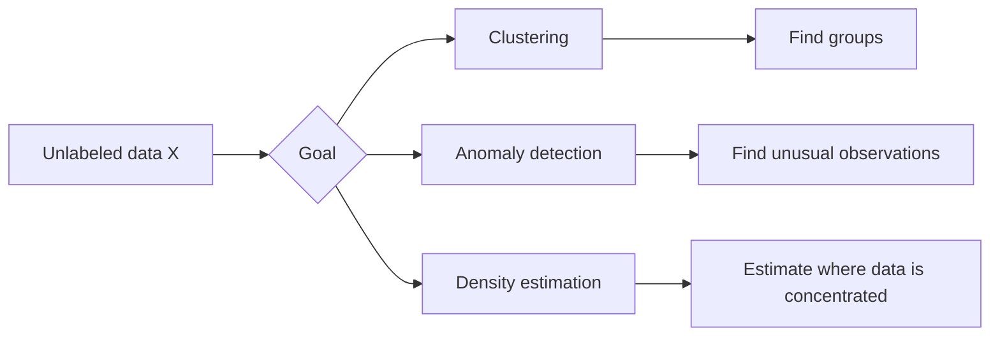
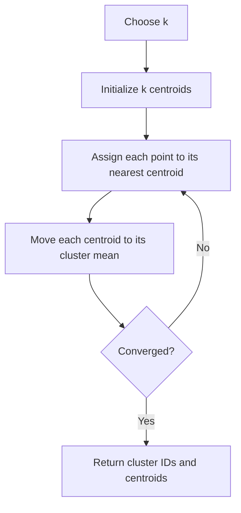

# Chapter 9: Unsupervised Learning and K-Means

## Learning objectives

By the end of this lesson, you should be able to:

- explain how unsupervised learning differs from supervised learning;
- describe clustering, anomaly detection, and density estimation;
- explain how K-Means assigns points and updates centroids;
- distinguish hard clustering from soft clustering;
- recognize when K-Means is useful and when its assumptions fail;
- prepare data and choose a reasonable number of clusters.

---

## 1. Why unsupervised learning?

Most real-world data has input features \(X\), but no target labels \(y\). Labels are
often expensive because they require people with domain knowledge to inspect and
classify each example.

Imagine a factory that photographs every product:

- collecting thousands of images is easy;
- labeling every image as **normal** or **defective** is slow and costly;
- product changes may make old labels less useful.

Unsupervised learning looks for useful structure in this unlabeled data.

> **Important:** an unsupervised algorithm can discover patterns, but it does not
> automatically know their real-world meaning. A person still needs to interpret and
> validate the result.

### Main unsupervised tasks

**Clustering** groups similar observations. Common uses include customer
segmentation, document organization, image grouping, and exploratory analysis.

**Anomaly detection** learns what normal observations look like and identifies
unusual ones. It is useful for fraud detection, manufacturing defects, and unusual
system activity.

**Density estimation** estimates where observations are common or rare in the
feature space. Very low-density observations may be anomalies.



---

## 2. Classification versus clustering

Both methods assign observations to groups, but they solve different problems.

- **Classification is supervised:** the training data already contains known class
  labels, such as `setosa`, `versicolor`, and `virginica`.
- **Clustering is unsupervised:** the algorithm receives only the features and must
  discover groups on its own.

### Conceptual visualization

The same point cloud can be viewed in two ways:

```text
CLASSIFICATION — classes are known       CLUSTERING — groups are discovered

feature 2                                 feature 2
   ↑                                         ↑
 8 |                ▲ ▲                    8 |                ● ●
 7 |            ▲ ▲     ■                  7 |            ● ●     ◆
 6 |          ▲       ■ ■                  6 |          ●       ◆ ◆
 5 |                                      5 |
 4 |                                      4 |
 3 |  ● ●                                 3 |  ■ ■
 2 | ●   ● ●                              2 | ■   ■ ■
 1 |  ● ●                                 1 |  ■ ■
   +----------------→ feature 1              +----------------→ feature 1

Markers represent known classes.            Symbols represent inferred clusters.
```

Cluster identifiers such as `0`, `1`, and `2` are arbitrary. Cluster `0` is not
better or worse than cluster `1`, and a cluster ID is not automatically a class label.

### What counts as a cluster?

There is no universal definition. Different algorithms look for different structures:

- points close to a center;
- connected high-density regions;
- nested groups;
- distributions with similar statistical properties.

K-Means uses the first idea: each cluster is represented by a central point.

---

## 3. Why clustering is useful

Clustering can support several tasks:

1. **Exploratory data analysis** — inspect each discovered group separately.
2. **Customer segmentation** — identify customers with similar behavior.
3. **Recommendation** — suggest items liked by users in a similar group.
4. **Search** — narrow a similarity search to a relevant cluster.
5. **Image segmentation** — group pixels with similar colors.
6. **Anomaly detection** — flag observations far from every cluster.
7. **Semi-supervised learning** — use a few labeled representatives to help label
   nearby observations.
8. **Feature engineering** — replace an observation with its distances or
   similarities to cluster centers.

Clustering results should be treated as hypotheses to investigate. A visually neat
grouping can still be irrelevant, unstable, or harmful in the real application.

---

## 4. K-Means

K-Means is a fast clustering algorithm for numeric data. It represents each cluster
using its **centroid**, the mean position of all observations assigned to that cluster.

The value \(k\) is the number of clusters and must be selected before training.

### Five-blob example

The `×` symbols below represent centroids:

```text
feature 2
   ↑
 9 |     • •                         • •
 8 |   •  ×  •                     • × •
 7 |     • •          • •            •
 6 |                •  ×  •
 5 |                  • •
 4 |       • •
 3 |     •  ×  •                       • •
 2 |       •                         •  ×  •
 1 |                                   •
   +------------------------------------------→ feature 1
       cluster 1      cluster 2          clusters 3–5
```

This sketch is conceptual: actual cluster assignments depend on distances, feature
scales, initialization, and the data.

### Basic use with scikit-learn

```python
from sklearn.cluster import KMeans

kmeans = KMeans(
    n_clusters=5,
    init="k-means++",
    n_init=10,
    random_state=42,
)

cluster_ids = kmeans.fit_predict(X)
centroids = kmeans.cluster_centers_
```

For new observations:

```python
new_cluster_ids = kmeans.predict(X_new)
distances_to_centroids = kmeans.transform(X_new)
```

`predict()` returns the nearest cluster ID. `transform()` returns one distance per
centroid, so data with any original number of features becomes a \(k\)-dimensional
distance representation.

---

## 5. How the algorithm works

K-Means alternates between assignment and update steps:

1. Choose \(k\) initial centroids.
2. Assign every observation to its nearest centroid.
3. Replace each centroid with the mean of its assigned observations.
4. Repeat steps 2 and 3 until the assignments or centroids stop changing, or a
   configured iteration limit is reached.



### Iteration sketch

```text
Initialization          Assignment             Update

• • •       ×           • • • |     ×          • • •
  •                     • •   |                  • ×
                       ------ | ------             |
        • •       ×             • •   ×            |    • •
      • • •                   • • •              × |  • • •

Centroids begin          Points select the       Centroids move to
at candidate positions.  nearest centroid.       their assigned means.
```

Each update does not increase the within-cluster squared-distance objective, so the
algorithm eventually converges. It may converge to a **local optimum**, however,
which is why trying multiple initializations is important.

---

## 6. What K-Means optimizes

K-Means minimizes the **within-cluster sum of squared distances**, often called
**inertia**:

\[
J = \sum_{i=1}^{m} \left\|x_i - \mu_{c_i}\right\|^2
\]

where:

- \(x_i\) is observation \(i\);
- \(c_i\) is its assigned cluster;
- \(\mu_{c_i}\) is that cluster's centroid;
- \(m\) is the number of observations.

Lower inertia means observations are closer to their assigned centroids. Inertia
always decreases as \(k\) increases, so it cannot by itself prove that a chosen \(k\)
is correct.

### Decision regions

Prediction assigns each point to its nearest centroid. This divides the feature space
into **Voronoi regions**:

```text
                 boundary
                    ╱
        region A   ╱   region B
                  ╱
             × A ╱       × B
                ╱
───────────────┼────────────────
               │
       region C│
          × C  │

Every location belongs to the region of its nearest centroid.
```

The boundaries are straight in ordinary Euclidean feature space. This helps explain
why K-Means struggles with curved or irregularly shaped clusters.

---

## 7. Hard and soft clustering

**Hard clustering** assigns each observation to exactly one cluster:

\[
c_i = \arg\min_j \left\|x_i - \mu_j\right\|
\]

**Soft clustering** gives each observation a score for every cluster. With K-Means,
the distances returned by `transform()` can be used as such a representation.
Smaller distance means a stronger association.

Distances are not probabilities. If probabilities or overlapping distributions are
needed, a probabilistic method such as a Gaussian mixture model may be more
appropriate.

---

## 8. Data preparation

K-Means depends directly on distance, so preprocessing matters.

### Scale numeric features

Suppose one feature ranges from 0 to 1 and another from 0 to 100,000. The second
feature will dominate Euclidean distance unless the difference is intentional.

```python
from sklearn.pipeline import make_pipeline
from sklearn.preprocessing import StandardScaler
from sklearn.cluster import KMeans

model = make_pipeline(
    StandardScaler(),
    KMeans(n_clusters=5, n_init=10, random_state=42),
)

cluster_ids = model.fit_predict(X)
```

### Check the feature meaning

- Remove identifiers such as customer IDs; numeric-looking IDs usually have no
  meaningful distance.
- Encode categorical data carefully. One-hot encoding may work in some cases, but
  Euclidean distance is not always suitable for categorical similarity.
- Handle missing values before fitting.
- Investigate extreme outliers because means and squared distances are sensitive to
  them.
- Reduce highly redundant dimensions when distance becomes uninformative.

---

## 9. Choosing \(k\)

There is rarely one objectively correct value.

### Domain knowledge

Choose \(k\) based on how the result will be used. If a team can act on only four
customer strategies, a 40-cluster solution may not be useful even if its metric is
slightly better.

### Elbow method

Fit several values of \(k\) and plot inertia. Look for a bend after which additional
clusters provide diminishing improvement:

```text
inertia
   ↑
   |●
   | \
   |  ●
   |    \
   |      ●  ← possible elbow
   |        ●─●─●
   +----------------→ k
      1  2  3  4  5  6
```

The elbow can be weak or subjective.

### Silhouette score

The silhouette score compares how close an observation is to its own cluster with
how close it is to the nearest other cluster:

- near \(1\): well separated;
- near \(0\): close to a boundary;
- below \(0\): possibly assigned to the wrong cluster.

Use metrics together with domain interpretation and stability checks. A high score
does not guarantee useful real-world groups.

---

## 10. Initialization and stability

Random initial centroids can produce different solutions.

`k-means++` spreads the initial centroids across the data and usually gives a better
starting point than naive random placement. `n_init` runs the algorithm multiple
times and keeps the solution with the lowest inertia.

For reproducible experiments, set `random_state`. Before trusting the result:

- repeat training with multiple seeds;
- compare cluster sizes and centroids;
- check whether similar observations remain grouped;
- inspect whether the discovered groups have a meaningful interpretation.

---

## 11. Limitations of K-Means

K-Means works best when clusters are roughly compact, similarly sized, and
separable under Euclidean distance.

It may perform poorly when:

- clusters have curved or non-convex shapes;
- clusters have very different sizes or densities;
- features use incompatible scales;
- many outliers pull the means;
- categorical features dominate;
- high-dimensional distances become less informative;
- a cluster contains very few observations.

```text
K-Means-friendly                 K-Means-unfriendly

   •••       •••                    •••••
  • × •     • × •                 •     •
   •••       •••                 •  •••  •
                                  • • × • •
Compact, separated blobs          •  •••  •
                                   •     •
                                    •••••
                                Nested/non-convex shapes
```

Possible alternatives include:

- **DBSCAN** for irregularly shaped dense regions and explicit noise points;
- **Gaussian mixture models** for probabilistic, elliptical clusters;
- **hierarchical clustering** when nested relationships matter;
- **K-Medoids** when greater robustness to outliers is needed.

---

## 12. Computational cost

For \(m\) observations, \(k\) clusters, \(n\) features, and \(t\) iterations, the
typical assignment cost is approximately:

\[
O(mknt)
\]

This is one reason K-Means is practical for large numeric datasets. For very large
datasets, `MiniBatchKMeans` updates centroids from small batches and can reduce
training time and memory use.

---

## 13. Recreate the main visualizations

The following script creates synthetic blobs, displays the K-Means centroids, and
shows the nearest-centroid decision regions. It reconstructs the ideas in this lesson
without requiring the original book figures.

```python
import matplotlib.pyplot as plt
import numpy as np
from sklearn.cluster import KMeans
from sklearn.datasets import make_blobs
from sklearn.preprocessing import StandardScaler

X, _ = make_blobs(
    n_samples=600,
    centers=5,
    cluster_std=[0.55, 0.8, 0.45, 0.7, 0.6],
    random_state=42,
)
X = StandardScaler().fit_transform(X)

model = KMeans(
    n_clusters=5,
    init="k-means++",
    n_init=10,
    random_state=42,
)
cluster_ids = model.fit_predict(X)

x0, x1 = np.meshgrid(
    np.linspace(X[:, 0].min() - 0.5, X[:, 0].max() + 0.5, 500),
    np.linspace(X[:, 1].min() - 0.5, X[:, 1].max() + 0.5, 500),
)
grid = np.c_[x0.ravel(), x1.ravel()]
regions = model.predict(grid).reshape(x0.shape)

plt.figure(figsize=(9, 6))
plt.contourf(x0, x1, regions, alpha=0.18, cmap="tab10")
plt.contour(x0, x1, regions, colors="gray", linewidths=0.6)
plt.scatter(
    X[:, 0],
    X[:, 1],
    c=cluster_ids,
    s=18,
    cmap="tab10",
    edgecolors="white",
    linewidths=0.25,
)
plt.scatter(
    model.cluster_centers_[:, 0],
    model.cluster_centers_[:, 1],
    marker="X",
    s=220,
    c="black",
    label="Centroids",
)
plt.title("K-Means clusters and Voronoi decision regions")
plt.xlabel("Standardized feature 1")
plt.ylabel("Standardized feature 2")
plt.legend()
plt.tight_layout()
plt.show()
```

---

## 14. Practical workflow

1. Define what similarity should mean for the problem.
2. Select meaningful features.
3. Clean missing values and obvious data errors.
4. Scale the features when their units differ.
5. Try several values of \(k\) and multiple initializations.
6. Compare inertia, silhouette score, and stability.
7. Visualize the result when possible.
8. Interpret clusters with domain experts.
9. Validate that using the clusters improves the downstream task.
10. Monitor the data because cluster structure can change over time.

---

## 15. Review questions

1. Why can collecting unlabeled data be easier than collecting labeled data?
2. What is the difference between a class label and a cluster ID?
3. What happens during the assignment and update steps of K-Means?
4. Why should numeric features often be standardized?
5. Why can two K-Means runs produce different results?
6. Why does lower inertia not always mean a better choice of \(k\)?
7. What types of cluster shape are difficult for K-Means?
8. How can distances to centroids be used as new features?

## 16. Practice tasks

1. Run the visualization script and change `n_clusters` to 3, 4, and 6.
2. Compare the inertia and silhouette score for each value.
3. Remove `StandardScaler` and observe how rescaling one feature changes the
   assignments.
4. Generate two moon-shaped groups with `sklearn.datasets.make_moons` and explain
   why K-Means struggles.
5. Add several extreme outliers and observe how the centroids move.

---

## Key takeaways

- Unsupervised learning extracts structure from data without target labels.
- Clustering groups observations according to a chosen definition of similarity.
- K-Means repeatedly assigns points to the nearest centroid and recomputes means.
- The algorithm minimizes within-cluster squared distance, not real-world meaning.
- Feature choice, scaling, \(k\), initialization, and validation strongly affect the
  result.
- K-Means is fast and effective for compact numeric clusters, but it is not suitable
  for every cluster shape or data type.
